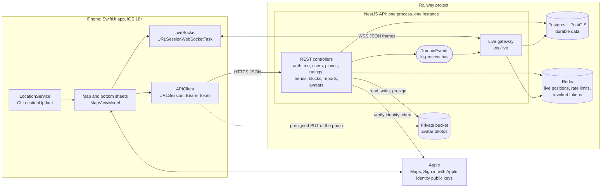
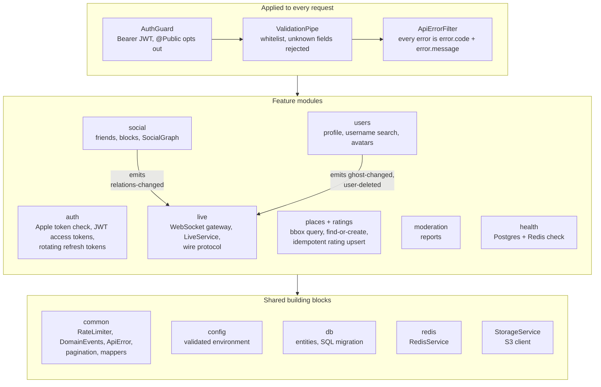
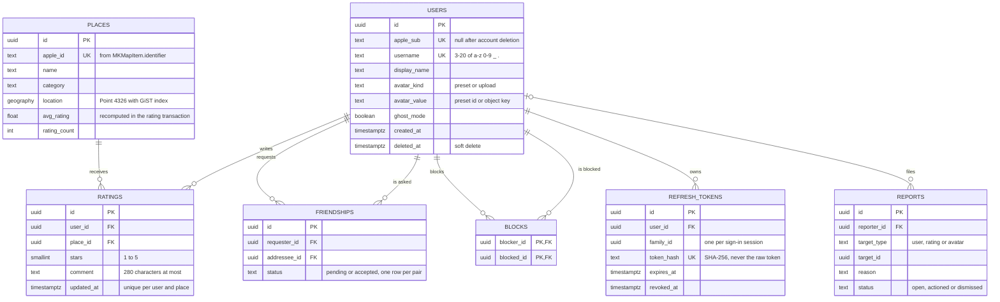
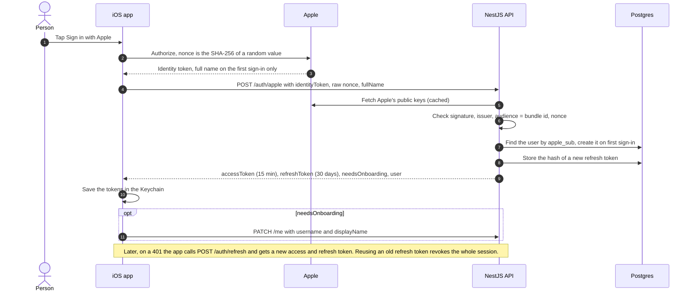
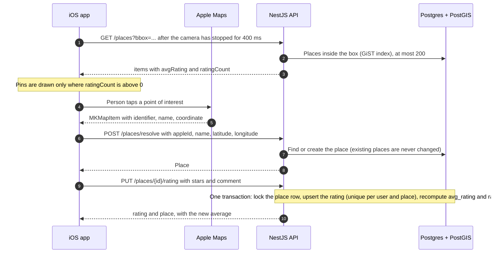
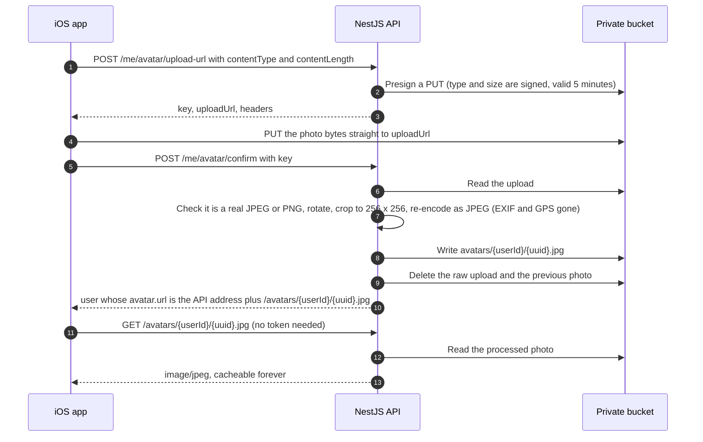
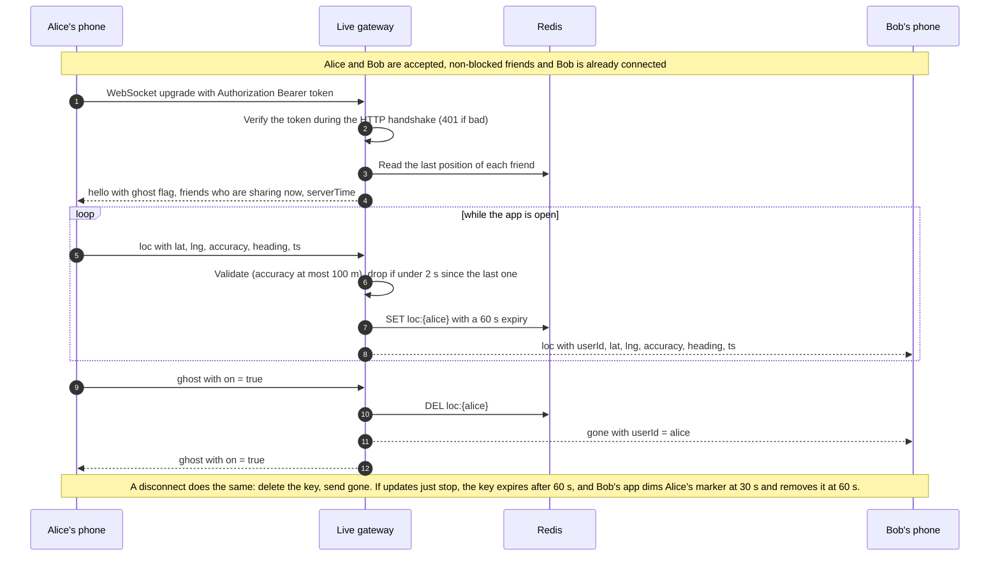
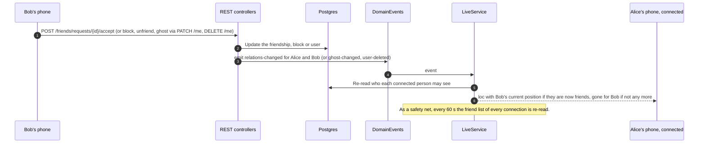

# Place Rating API

Backend for a one-screen iOS app where people rate places on a map, each person has an avatar, and friends see each other's live location (Snapchat-map style). It follows the design spec: friends-only live location, preset avatars plus photo upload, everyone's average ratings.

**Stack:** NestJS 12 (ESM) · TypeORM 1.x on Postgres 16 + PostGIS · Redis (live locations, rate limits) · `ws` WebSocket · S3-compatible private bucket for avatar photos (served through the API) · Sign in with Apple · Vitest.

**Live:** `https://place-rating-api-production.up.railway.app` (health check at `/health`), hosted on Railway. **Building the iOS app?** Start with [`CLAUDE.md`](CLAUDE.md) and the [`docs/`](docs) folder.

## Architecture

### System overview

The phone talks to the API over HTTPS and one WebSocket. Postgres keeps everything durable, Redis keeps everything short-lived, and the bucket keeps avatar photos. Only the WebSocket path carries live location, and it ends in Redis.



### Inside the API

Every request passes the same three global pieces; the feature modules sit behind them and share a small set of building blocks. REST changes that affect a connected socket (a friend accepted, a block, ghost mode, account deletion) reach the live module through the in-process `DomainEvents` bus, so the two sides never import each other.



### Data model

Six durable tables plus the refresh-token table. Live location is never written to Postgres.



### Where each piece of data lives

| Data | Where | How long |
| --- | --- | --- |
| Accounts, places, ratings, friendships, blocks, reports, refresh-token hashes | Postgres + PostGIS | Until deleted (account deletion anonymises the user and removes their ratings, friendships, blocks, sessions and photo) |
| A person's latest live position | Redis `loc:{userId}` | 60 s after the last update; deleted on disconnect or ghost mode; never in Postgres, no history |
| Rate-limit counters | Redis `rl:...` | One minute, hour or day window |
| "This user was deleted" marker for access tokens | Redis `revoked:user:{userId}` | Access-token lifetime + 60 s |
| Avatar photos | Private bucket `avatars/{userId}/{uuid}.jpg` (256 px JPEG, no EXIF), served through `GET /avatars/...` | Until replaced or the account is deleted |
| Raw avatar uploads | Private bucket `uploads/{userId}/{uuid}` | Until confirmed or rejected (abandoned ones are not cleaned up yet) |
| Preset avatars | Shipped inside the iOS app; the API stores only the preset id | n/a |

## Data flows

### 1. Sign in

Sign in with Apple is the only way in. The API checks Apple's signature itself, then issues its own tokens, so the app never holds an Apple credential after sign-in.



### 2. Browse the map and rate a place



Sending the same `PUT` twice leaves the same state, so a retry after a dropped connection is always safe.

### 3. Avatar photo

The photo goes from the phone straight to the bucket; the API only signs the upload and then checks and rewrites the file. The bucket is private, so the API also serves the finished picture.



### 4. Live location



The phone sends at most one `loc` every 3 s, skips moves under 10 m, and still sends a heartbeat every 15 s so the 60 s expiry never lapses while the person stands still. Sharing stops when the app leaves the foreground. Full rules: [`docs/live-protocol.md`](docs/live-protocol.md).

### 5. Friend, block, ghost and deletion changes reaching a live socket



## Run it locally

```bash
docker compose up -d            # Postgres + PostGIS, Redis, a fake S3 (moto) for avatars
cp .env.example .env
npm install
npm run start:dev               # http://localhost:3000, migrations run on startup
```

`.env.example` turns on `DEV_AUTH_ENABLED`, so you can work without a Sign in with Apple setup:

```bash
curl -s localhost:3000/auth/dev -H 'content-type: application/json' -d '{"username":"alice"}'
# -> { "accessToken": "...", "refreshToken": "...", "user": { ... } }
export TOKEN=...                 # the accessToken
curl -s localhost:3000/me -H "authorization: Bearer $TOKEN"
```

`/auth/dev` is a 404 unless `DEV_AUTH_ENABLED=true`, and the server refuses to start with it on when `NODE_ENV=production`.

Try the live socket with two terminals (`npx wscat` is handy):

```bash
npx wscat -c ws://localhost:3000/live -H "authorization: Bearer $TOKEN"
> {"t":"loc","d":{"lat":30.0444,"lng":31.2357,"accuracy":12,"heading":90,"ts":1760000000000}}
```

## Tests

```bash
npm test            # unit tests, no services needed
npm run test:e2e    # end-to-end: real Postgres+PostGIS, Redis, S3-compatible server, real sockets
npm run lint
```

### Checking a running server

`npm run smoke` (or `node scripts/smoke.mjs [baseUrl]`) is a black-box check of the API you started with `npm run start:dev`: every REST route and the live socket, success and failure cases, about 65 checks in roughly a minute. It needs `DEV_AUTH_ENABLED=true` and reads `.env` for the port, Redis and Postgres. It creates its own throw-away people and places (usernames `s<random>…`, places `Smoke <random> …`), removes them at the end, and writes the result to `scripts/smoke-report.txt`. Use `--skip-slow` to leave out the 45 s dead-connection check.

`test:e2e` uses the services from `docker compose up -d` (it creates a separate `placerating_test` database and uses Redis database 1). Point it elsewhere with `DATABASE_URL`, `REDIS_URL`, `S3_*` environment variables.

The fake S3 keeps files in memory, so avatars you upload during development disappear when you restart that container (`docker compose restart s3`); the database rows then point at pictures that no longer exist. Re-upload or pick a preset.

## REST API

All routes except `/auth/*` and `/health` need `Authorization: Bearer <accessToken>`. Errors always look like `{ "error": { "code": "...", "message": "..." } }`. Lists use cursor pagination (`?limit=20&cursor=...`, response has `nextCursor` or `null`).

| Method & path | What it does |
| --- | --- |
| `POST /auth/apple` `{identityToken, nonce?, fullName?}` | Verifies the Apple identity token, creates the account on first sign-in. Returns `{accessToken, refreshToken, expiresIn, needsOnboarding, user}` |
| `POST /auth/refresh` `{refreshToken}` | Rotates the refresh token. Reusing an old one revokes the whole session family |
| `POST /auth/logout` `{refreshToken}` | Revokes that session |
| `POST /auth/dev` `{username}` | Development-only sign-in (see above) |
| `GET /me`, `PATCH /me` `{username?, displayName?, ghostMode?, avatarPreset?}` | Profile. `username` is 3-20 chars of `a-z 0-9 _ .`, unique, lowercased |
| `DELETE /me` | Deletes the account: ratings, friendships, blocks and sessions go; the row is anonymised; friends are told the marker is gone |
| `POST /me/avatar/upload-url` `{contentType, contentLength}` | Presigned S3 `PUT` URL for a JPEG/PNG up to 5 MB |
| `POST /me/avatar/confirm` `{key}` | Re-encodes the upload to a 256 px JPEG (strips EXIF), swaps the avatar, deletes the old object |
| `GET /users/search?q=` | Username prefix search, 3+ chars, max 20, excludes you and blocked people, shows `friendStatus` |
| `GET /places?bbox=minLng,minLat,maxLng,maxLat` | Places in the box (max 200, box at most 5 degrees wide) |
| `POST /places/resolve` `{appleId?, name, category?, latitude, longitude}` | Finds or creates the place for what the person picked. Existing places are never changed by clients |
| `GET /places/:id` | Place with average, count and your own rating |
| `GET /places/:id/ratings` | Ratings newest first (hides blocked people) |
| `PUT /places/:id/rating` `{stars 1-5, comment?}` / `DELETE` | Create/replace/remove your rating. Idempotent. The average is recomputed in the same transaction |
| `GET /friends` | `{friends, incoming, outgoing}` |
| `POST /friends/requests` `{userId}` | Send a request (accepts instead if they already asked you) |
| `POST /friends/requests/:id/accept` | Accept an incoming request |
| `DELETE /friends/:userId` | Remove a friend, cancel or decline a request |
| `GET /blocks`, `POST /blocks` `{userId}`, `DELETE /blocks/:userId` | Blocking also removes any friendship |
| `POST /reports` `{targetType: user\|rating\|avatar, targetId, reason, details?}` | Report content (App Review UGC requirement) |
| `GET /avatars/:userId/:file.jpg` | Public, no token: streams a processed avatar photo from the bucket with `Cache-Control: immutable`. This is the `avatar.url` the other routes return |
| `GET /health` | 200 only when Postgres and Redis answer |

Rate limits (per person, in Redis): 30 rating writes/hour, 20 friend requests/day, 60 username searches/hour, 10 avatar uploads/hour, 20 reports/day, 120 place lookups/hour; 30 sign-in calls/minute per IP.

## Live location: `ws://host/live`

Connect with `Authorization: Bearer <accessToken>` on the upgrade request (a bad token gets an HTTP 401, no socket). Frames are JSON `{"t": type, "d": data}`.

| Direction | Frame | Meaning |
| --- | --- | --- |
| client → server | `loc` `{lat, lng, accuracy, heading, ts}` | Your position. Accuracy worse than 100 m is rejected; updates closer than 2 s apart are dropped; `heading` -1/null = unknown |
| client → server | `ghost` `{on}` | Hide yourself (saved on your profile, survives reconnects) |
| server → client | `hello` `{userId, ghost, friends: [{userId, lat, lng, accuracy, heading, ts}], serverTime}` | Sent once on connect: last known position of each friend |
| server → client | `loc` `{userId, lat, lng, accuracy, heading, ts}` | A friend moved |
| server → client | `gone` `{userId}` | Remove that marker (they disconnected, went ghost, unfriended or blocked you, or deleted their account) |
| server → client | `ghost` `{on}` | Confirms your ghost setting |
| server → client | `error` `{code, message}` | Your last frame was rejected |

Close codes: `4401` unauthorized, `4403` account deleted, `4409` replaced by a newer connection of yours (one connection per person), `4429` too many messages, `4400` too many invalid messages, `1009` frame over 2 KB.

Rules the server enforces: only accepted, non-blocked friends receive your position and only if you are not in ghost mode; your latest position lives only in Redis (`loc:{userId}`, 60 s expiry, deleted on disconnect or ghost) and nothing is written to Postgres; the server pings every 20 s and closes sockets that stop answering.

Suggested client behaviour (from the spec): send at most one `loc` per 3 s and skip moves under 10 m, but still send a heartbeat `loc` every 15 s so the 60 s expiry never lapses; reconnect with backoff 1, 2, 4, 8, 16, then 30 s with jitter; dim a marker after 30 s without an update and drop it after 60 s.

## Deploying to Railway

`railway.json` already holds the build, start command (`node dist/main.js`) and health check (`/health`). The project needs four services, all in one Railway project:

| Service | What | Notes |
| --- | --- | --- |
| **API** | this repo (GitHub deploy) | the variables below |
| **PostGIS** | Railway's "PostGIS" template (`postgis/postgis`) | the plain Postgres template has no PostGIS and the first migration needs it |
| **Redis** | Railway's Redis | |
| **Bucket** | Railway Storage Bucket | private; the API serves avatars itself |

Variables on the API service (`${{Name.VAR}}` are Railway references to the other services; use their actual names):

```
NODE_ENV=production
DATABASE_URL=${{PostGIS.DATABASE_URL}}
REDIS_URL=${{Redis.REDIS_URL}}
JWT_SECRET=${{ secret(64) }}                 # or any random string of 32+ characters
APPLE_BUNDLE_ID=<your iOS app's bundle id>
S3_ENDPOINT=${{Bucket.ENDPOINT}}
S3_REGION=${{Bucket.REGION}}
S3_BUCKET=${{Bucket.BUCKET}}
S3_ACCESS_KEY_ID=${{Bucket.ACCESS_KEY_ID}}
S3_SECRET_ACCESS_KEY=${{Bucket.SECRET_ACCESS_KEY}}
S3_FORCE_PATH_STYLE=false                    # true only if the bucket's Credentials tab says path-style
AVATAR_PUBLIC_BASE_URL=https://${{RAILWAY_PUBLIC_DOMAIN}}
```

Do not set `DEV_AUTH_ENABLED` or `S3_AUTO_CREATE_BUCKET` there (the server refuses to start in production with the first one on). Then generate a public domain for the API service. Migrations run on startup. Because nobody can sign in without Apple in production, the API stays empty until the iOS app sends real Sign in with Apple tokens; change `APPLE_BUNDLE_ID` to the real bundle id before then.

## Layout

```
src/
  config/       typed, validated environment
  db/           entities, the initial SQL migration (runs on startup), database module
  auth/         Apple token verification, access/refresh tokens, global auth guard
  users/        profile, search, avatar presets and photo upload (S3)
  places/       bbox query, find-or-create       ratings/   idempotent rating upsert + aggregates
  social/       friends, blocks, "who can see whom"
  moderation/   reports
  live/         WebSocket gateway, Redis presence, wire protocol
  common/       error envelope, rate limiter, pagination, shared mappers
test/           end-to-end specs (REST, avatars, live socket)
scripts/        smoke.mjs, a black-box check of a running server
docs/           API contract, live protocol, data model, product spec, iOS app brief, operations
CLAUDE.md       context for Claude Code sessions (start here when building the iOS app)
```

Places and ratings use SQL instead of entities because of the `geography` column and the aggregate recompute; everything else uses TypeORM repositories.

## What was and wasn't verified

Verified in the sandbox where this was written: build, lint, 54 unit tests and 49 end-to-end tests against a real Postgres 16 + PostGIS 3.4, a real Redis 7 and real WebSocket connections, including concurrent rating writes, ghost mode, unfriend/block/deletion while connected, ping timeouts and flooding. Avatar upload ran against **moto**, the same S3 mock `docker compose` starts, not against real AWS S3 or R2, so try one upload against your real bucket before shipping.

**Not verified:** real Sign in with Apple tokens (the e2e tests replace the verifier with a fake; `src/auth/apple-verifier.ts` is the only code that talks to Apple), anything on iOS, and running more than one API instance.

## Things to know before shipping

- **Apple account deletion:** App Review expects you to also revoke the person's Sign in with Apple token when they delete their account (Apple's `/auth/revoke` endpoint, which needs a client secret generated from your Apple developer key). Not implemented here; deletion removes everything on our side only.
- **One instance only for live location:** pushes to friends happen in memory of the process that holds the socket. With several instances, friends on another instance would not get updates. Fix by publishing frames through Redis pub/sub (positions are already in Redis, so `hello` works everywhere).
- **PostGIS is required.** The first migration runs `CREATE EXTENSION postgis`; use the `postgis/postgis` image or a host whose Postgres offers the extension.
- **Avatars go through the API:** the bucket stays private (Railway buckets cannot be public). Photos live under `avatars/<userId>/<id>.jpg` and `GET /avatars/...` streams them; `AVATAR_PUBLIC_BASE_URL` is this API's own public address. Each photo is fetched once per device because responses are cacheable forever, but if avatar traffic ever gets large, put a CDN in front of that route. Unconfirmed uploads under `uploads/` are never cleaned up automatically; add a lifecycle rule that expires them after a day on a bucket that supports it (Railway's does not yet).
- **Moderation:** reports are stored (`reports.status = 'open'`) but there is no admin tool yet; review them in SQL until there is.
- **Logs:** the WebSocket adapter logs an error for every oversized frame, so a logged-in client could spam your logs; add log sampling or a rate limit at the proxy if that matters.
- **Production env:** set `NODE_ENV=production`, a real `JWT_SECRET` (`openssl rand -base64 48`), `APPLE_BUNDLE_ID`, `DATABASE_SSL` if your host needs TLS, and the `S3_*` / `AVATAR_PUBLIC_BASE_URL` values. Start with `npm run build && npm run start:prod`.
